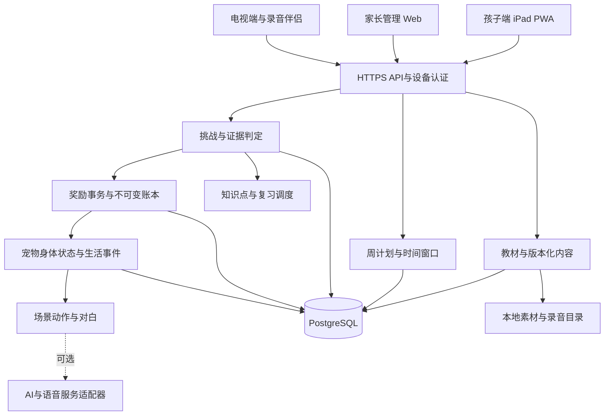

# 伴学小岛：英语学习打卡与宠物陪伴应用规划设计方案

## 1. 产品愿景与落地路线

让孩子拥有一个愿意主动回来照顾的小伙伴，在固定时间完成自己参与制定的英语学习约定，用学习成果建设彼此共同生活的小世界。

产品由两条相互连接、各自清晰的主线组成：学习主线负责教材、计划、挑战、复习与掌握证据；宠物主线负责性格、身体需要、成长、场景生活与共同回忆。学习为宠物生活提供食物和建设材料，宠物生活为学习提供有意义的情境。

建议先做可安装到 iPad 主屏幕的 Web/PWA，后端支持 NAS Docker。用家庭真实使用验证学习与养成闭环，再增加 Android TV 客户端和 AI 互动。首版采用模块化单体，不上微服务，不依赖大模型才能使用。

暂定产品名“伴学小岛”，名称、角色和美术均可替换。首个家庭试用版本以一个孩子、一只主宠、RAZ 与新概念各一段真实教材内容为目标；应用内必须具备所选范围的课文/绘本内容、词句与对应验证，不能只有教材名称和目录。数据模型从一开始支持多个家庭成员与多个孩子。

### 1.1 首版必须成立的体验

1. 家长能在一次周末安排中设置下一周每天学什么、何时挑战、做哪些验证。
2. 孩子继续使用纸书、点读笔和原有学习 APP；本应用清楚显示任务，并验证目标词句。
3. 验证通过或经家长确认后获得对应奖励，重复提交不重复发放。
4. 孩子能把食物真正喂给宠物，看到身体状态、行为和情绪变化。
5. 宠物会记得孩子的名字、食物偏好和共同经历，即使没有 AI 也有自然反馈。
6. 到点能开始、超时会收尾，不能通过刷题无限延长娱乐时间。
7. NAS 重启、设备断网、语音误判，不会造成奖励丢失、宠物异常死亡或儿童任务被误记为失败。

### 1.2 教材理解与使用方式

RAZ 是分级阅读体系，适合按级别、绘本、阅读主题组织任务。使用重点是听读、词图关联、句式重复、阅读理解与复述。家中点读版的册序、名称、配套内容可能不同于官方网站，导入时以实际持有版本建立映射，不用“第几本”作为永久主键。

新概念需要区分《新概念英语》经典版、《新概念英语青少版》及具体 APP 使用的版本，不能默认小学启蒙孩子就在学经典第一册。更适合按册、单元、课次和目标句型组织学习，不强制每天学一课。正式录入前确认教材封面、版本和当前进度即可。

本应用内部建立与外部学习工具相同教材、相同版本、相同学习范围的内容库。家长从真实绘本/课文中选择本周每天的页段、词汇与句子；孩子在原 APP 或点读笔上学习；应用使用这些原文词句和对应图片进行训练与结果验证。

“同步”指学习内容对齐，不要求点读笔或外部 APP 自动回传学习记录。直接打开其他 APP 的深链、进度回传，需取得相应平台能力或授权后单独接入。没有平台 API 时，仍可通过相同教材内容和手动“学完了，开始训练”完成闭环。

### 1.3 教材内容对齐的硬规则

- RAZ：教材系列→版本/来源→级别→具体绘本→页/段→句子→词汇与目标能力。
- 新概念：教材系列→版本→册→单元/课次→对话/段落→句子→词汇、句型与目标能力。
- 一个每日任务锁定具体教材版本与内容范围，不能只写“今天学 RAZ 20 分钟”。
- 当天验证默认只覆盖当天选中的词句；复习题必须来自孩子已经学过的范围，并明确标记复习。
- 同一个词在不同教材出现，可关联同一词义知识点；仍保留每次教材出处，不能把不同词义、句型和难度自动合并。
- 显示“教材原文”和“情境变式”来源标签。宠物情境可改变呈现形式，不任意增加未学词或改变原句含义。
- 同级别、同主题、同教材名称都不足以证明对齐。需核对实际句子、图片语义及版本。

### 1.4 一段教材如何形成一轮训练

用自编示意文本说明数据关系：某选中页段包含 “This is my bag.”、“It is blue.”，目标为 bag、blue 与对应句型。计划选择该页段及这两个词后，训练可依次使用听 bag 选图、看图认读 bag、听原句选图、选择 “It is ___. ”中的 blue，再录一句原文。

每道题保留 source_sentence_id、source_page_id 和 objective_id，家长能从题目返回原教材位置。目标词句录入后，可复用不同题型模板生成候选题，但词图搭配、干扰项和可接受答案要审核。

训练模式可反复试听、查看目标、跟读与接受提示；验证模式在同范围另抽题或换呈现，不直接重复刚显示过的答案。两者分开记录，只有预排任务的验证完成才能发对应奖励，反复练习不重复发粮。

例如家长只选“本课第1–4句”，出题器不得因为本课还有其他句子，就把未选择的第8句放进验证；医院复习也遵守已学范围。

## 2. 用户与权限

| 角色 | 可执行操作 | 限制 |
|---|---|---|
| 家庭管理员 | 创建家庭、绑定设备、配置教材、备份、设置家长权限和外部 AI | 不把系统密钥暴露给儿童端 |
| 家长 | 制定计划、审核资料与题目、复核录音、请假、调整开放时段、照护托管 | 修改已执行规则需保留历史，不追溯扣奖励 |
| 孩子 | 参与选计划、选宠物和昵称、完成挑战、喂养、装扮、查看成长记录 | 不可修改题目答案、奖励倍率、系统时间和家长规则 |
| 电视展示设备 | 展示已授权孩子的场景与挑战，接受遥控器操作 | 不提供完整家庭管理与原始录音列表 |

一个家庭可以有多个孩子，每个孩子有独立学习进度、计划、奖励账本和主宠。首版每个孩子只同时养一只主宠，避免每日资源被多只宠物分摊。后续多宠采用共享学习收益、分开的照顾关系，不把同一份学习奖励按宠物数量复制。

家长入口用独立家长身份或本机系统认证保护。家庭共用设备可提供家长 PIN 便捷入口，但服务端仍须检查角色；仅隐藏按钮不能形成权限保护。电视首次用一次性配对码由家长授权，不要求孩子在电视输入复杂账号。

## 3. 一次完整的每日体验

### 3.1 学习前

孩子打开应用，宠物根据当前时段迎接：“晚上好，今天我们约好读一本小书。你想先听，还是先跟读？”主页只突出一项当下行动。

在任务详情中显示：教材封面或自有图标、具体册次、学习目标、建议用时、学习方式和验证方式。例如：“拿出 RAZ 对应绘本，用点读笔听一遍，再跟读两遍。回来帮我挑对食物。”

孩子点击“去学习”，进入简单计时页，也可以离开应用使用原来的 APP。计时只用于节奏提示，不作为学会的证明；切换 APP 不判作弊，不要求摄像头全程监督。

### 3.2 先训练，再验证

孩子回来点击“我学好了”，先进入当天教材范围的短训练。训练页可看原句、听示范、认词、跟读，错误立即给解释；已熟悉的孩子可按家长规则跳过额外训练，直接验证。

点击“准备验证”后，系统从同一页段和目标词句中另选少量挑战，隐藏训练答案与即时提示。每题一步，答错可退出验证进入引导，再做一个同目标变式。最终记录“独立完成”“提示后完成”“家长确认”，而不是只给一个分数。补救不要求整套重来，训练次数与验证证据分别保存。

挑战完成后，奖励直接进入背包，结算动画显示来源：“这份主食来自今天的阅读挑战。”孩子选择喂食，宠物主动走向饭碗、闻一闻、进食，再用动作和短句表达满足。

学习结束后，开放短时间照顾与互动。到点宠物进入休息：“今天的小约定完成啦，我要睡一会儿。明天见！”系统保存状态并结束本轮互动。

### 3.3 真实体验时长建议

低龄试运行可从外部学习约 8–12 分钟、验证约 3–5 分钟、宠物照顾约 2–3 分钟开始；具体以孩子能力和疲劳调整。这是产品节奏建议，不是医学或教学定额。屏幕内不需要覆盖全部英语学习时间，纸书与户外活动仍在应用之外进行。

## 4. 每周计划与时间观念

### 4.1 制定周计划

家长先选择家庭时区、计划周、学习日与休息日，再选择教材和当前内容。系统按学习目标拆成短任务，家长检查难度，孩子参与选择宠物本周愿望、任务顺序以及两个允许时段中的一个。

每个计划任务必须包含：日期、教材版本、具体绘本/课次、页段/句子ID范围、目标词句、外部学习说明、预计用时、训练题型、验证模板、是否必做、奖励档位、可开放时段、复习来源和家长复核方式。

家长的实际操作是“选教材→选版本→选书/课→勾选页段或句子→选择需要训练的词和能力→分配到周一至周日”。右侧同时预览教材原句、当天训练样例、验证覆盖与宠物奖励，避免先填日历再手动找题。支持把一课拆成数天，也支持同一天安排 RAZ 阅读和一小段新概念复习。

同一天建议一项主要新学任务，必要时加一项短复习。不要把 RAZ 与新概念每天都安排成同等重量的新内容。先用孩子熟悉的内容校准验证难度。

### 4.2 周计划示例

以下词句为自编示例，不对应某一官方绘本或课文；实际试用替换为孩子当前合法持有教材中的目标。

| 日期 | 外部学习 | 应用内验证 | 宠物情境 | 预期奖励 |
|---|---|---|---|---|
| 周一 | RAZ 当前级别一本熟悉绘本，听读与跟读 | 词图识别 2 题、听句选图 1 题、目标词朗读 1 次 | 为宠物整理餐盘 | 主食份额、少量建材 |
| 周二 | 新概念当前课的一个短对话片段 | 单词认读 2 个、句型跟读 1 句 | 在家认识新朋友 | 主食份额、装饰素材 |
| 周三 | 复习周一目标，不增加新课 | 变式选图 2 题、口头说一句 | 公园找物品 | 主食份额、叶片素材 |
| 周四 | RAZ 下一本适量内容，或继续当前本 | 听力匹配、句子理解各少量 | 帮宠物布置窝 | 主食份额、布料素材 |
| 周五 | 新概念复习周二句型 | 句子选词；有拼写基础再填空 | 和宠物打招呼 | 主食份额、木料素材 |
| 周六 | 不设强制新学，散步后自愿复述 | 可选亲子口语或家长确认 | 公园野餐 | 占用已预排可选任务配额，不无限加奖 |
| 周日 | 亲子回顾和选下周内容，可休息 | 查看已会、待复习，孩子选一个愿望 | 翻共同相册 | 已约定周目标完成后一次建设奖励 |

家长可设置一周五个计划学习日，达到其中四天视为周约定达成；日任务完成率与周约定完成率分别显示。休息、请假不伪装为学习完成，也不记作知识不会。

### 4.3 固定开放时间的详细规则

建议默认挑战窗口 19:00–19:30，最晚新开挑战 19:25，已开始的一轮最多到 19:35 收尾；宠物自由互动在当天任务完成后开放约 3 分钟且受总上限限制。实际时刻由家长调整。

系统至少分开四个时间参数：允许进入挑战的窗口、单轮挑战上限、每日互动预算、当天最晚结束时刻。纸书离线学习不受界面倒计时控制，应用只能限制自身挑战与互动，不能代替 iPad 屏幕使用时间或电视家长控制。

- 窗口前：允许查看今日约定和宠物静态状态，不允许提前刷挑战。倒计时只在主动打开页面时展示，不做全天焦虑提示。
- 窗口中：主按钮为“开始今天的小约定”；提供“我需要帮助”。
- 临近结束：只提示一次；新一轮长度超过剩余时间时不再开启。
- 超时：保存当前题及已完成证据，允许短收尾；不在孩子录音中途突然强退。
- 错过窗口：显示“今天的时间过去了，和家长商量下次安排”；家长可批准一次补做，记录真实完成时间。
- 请假：家长设置请假日期与托管，保留成长关系；不伪造学习成果。
- 改计划：未开始任务可替换；进行中和已完成任务保留版本与结果，新规则只影响之后的任务。

服务端按家庭固定 IANA 时区确定学习日。客户端时钟只负责显示，改设备时间不能延长窗口；跨午夜、夏令时及旅行需明确按家庭时区还是家长批准的新时区执行。首版默认 Asia/Shanghai，修改时区对下一学习日生效，避免重复结算。

## 5. 打卡验证与挑战系统

### 5.1 必须区分的结果

“参加了学习”“通过了本次验证”“已经掌握某项能力”是不同概念。计时结束仅记录参与，客观题或人工复核产生验证证据，多次间隔复习才形成掌握趋势。

挑战以知识点为中心，分别记录听辨、词形识别、朗读、句意理解、拼写与口头表达，不能因为选对了图片，就标记孩子会拼写或发音准确。

### 5.2 题型与可实施判定

| 题型 | 孩子操作 | 能验证什么 | 首版判定与替代方案 |
|---|---|---|---|
| 听词选图 | 听 apple，选正确图片 | 听辨及词义关联 | 客观答案自动判定；重播指令不扣分 |
| 看词识图 | 看到 apple，选择图片 | 词形与词义关联 | 不自动念出目标词，避免泄露被测能力 |
| 看图选词 | 根据图片选择单词 | 词义与词形识别 | 大按钮，避免选项只靠细小字母区别 |
| 单词认读 | 看词后录音 | 词汇口头输出 | 首版录音+家长轻确认，自动识别后续可选 |
| 听句选图 | 听句子后选场景 | 句子理解 | 客观答案判定，选项需避免歧义 |
| 句子口语 | 跟读或看图说一句 | 跟读、表达，不同模式分开 | 内容匹配和发音质量分开记录；人工可复核 |
| 句子填单词 | 选择或输入缺词 | 语境、词汇或拼写 | 选词与手输不是同一能力；枚举允许答案 |
| 连线 | 词与图、问句与答句匹配 | 关联与理解 | 平板可拖动，也必须支持先点左项再点右项 |
| 句子排序 | 排列少量词块 | 句式结构 | 接受预先审核的多个有效顺序，标点规则可配置 |
| 简短阅读理解 | 阅读后选答案 | 信息理解 | 内容短、题量少，不用超出目标的生词干扰 |
| 复述/自由表达 | 录音描述绘本或实物 | 迁移与主动表达 | 首版家长确认，AI只给建议，不独立裁决 |

未识字孩子使用语音指令、图示和演示。题目中的操作说明可朗读，待测词形是否朗读由能力目标决定。不能为了方便而把阅读题悄悄变成听力题。

### 5.3 通过规则

初始规则采用显式题单蓝图。例如一轮包含3个客观验证项和1个必需朗读项：客观项达到2/3，朗读项经家长或经校准的评估确认，且每个必需目标都有对应证据，才可完成。若不测朗读，可采用4个客观项达到3/4，同时检查必需目标覆盖。不同能力不简单相加成一个总分，题单必须明确各部分分母、通过条件和可接受的帮助程度。

总分达标但某个必需能力完全未测时，不标记该能力完成；应补足一个短项、调整未开始的计划或由家长确认。未识别属于技术/证据状态，不计入错误分母，避免系统故障拉低通过率。

未达到时先提示，再给同目标的一个短变式，不要求重做整轮。两次主动重试后显示家长帮助入口，允许暂停。人工确认可以完成奖励流程，同时保留“提示后完成”或“人工确认”的证据，不修改原机器结果。

基础食物奖励对独立完成和认真纠错后完成保持一致，优秀表现用成长回忆、表扬和较小的建设奖励体现，避免孩子为了更容易获奖只选简单内容。

### 5.4 语音验证分阶段

第一阶段：浏览器录音、播放复听、家长一键确认。先让完整闭环成立，避免自动评分误伤孩子。

第二阶段：接入英文语音识别，检查目标词是否出现、句子内容是否大致正确。识别置信度不等于发音分数，不直接把 ASR 转写差异判成发音错误。

第三阶段：如确有需要，接入支持儿童英文与目标年龄测试的专业发音评测服务，分开准确度、完整度、流利度等结果，并用家庭样本校准阈值。不能在尚未实测前承诺“准确自动判断所有口语”。

无声、噪音、多人说话、拒绝麦克风、网络失败均为“未识别/待确认”，不算知识错误，不扣能量与关系。文案用“我没听清，可以再说一次，或者请家长帮忙”。经过两次重录仍可走人工；改成点选只能获得识别能力证据，不能冒充朗读通过。

### 5.5 复习调度

初始采用可解释的规则：当天学过、下一计划学习日复习、约三天后变式、下周再次检查；日期落在休息日则移动到下一计划学习日。答错或依赖提示的目标优先排入复习，已会内容降低频率。

每个知识点记录最近证据、帮助程度、题型、复习次数和下次到期日。医院、公园等场景从这个知识点池选择题目，不生成独立于教材的随机考试。

## 6. 宠物世界与生命系统

### 6.1 宠物的感情如何成立

宠物具有稳定性格、个人偏好、身体状态、情绪与共同记忆。性格改变表达方式，不改变学习公平性。例如外向的小狗更喜欢迎接动作，安静的小猫更喜欢坐在旁边观察；两者所需学习量和可得奖励相同。

情感来自连续性：它记得上次孩子给窝铺了什么颜色的毯子，喜欢哪种合适的零食，知道一起第一次完成了哪本书。它会主动看窗外、闻新食物、叼起玩具，而不是一直站着播报任务。

可记录的回忆例子：“第一次听你读完整句话”“雨天一起整理了小窝”“第一次公园散步”。不收集无关隐私，不用“你不学我就不喜欢你”之类台词。

### 6.2 状态拆分

| 状态 | 范围/单位 | 变化来源 | 主要表现 |
|---|---|---|---|
| 饱腹 Satiety | 0–100 | 食物增加，随允许计时下降 | 找饭碗、吃饱后停止进食 |
| 水分 Hydration | 0–100 | 加水增加，日常减少 | 喝水、舌头舔碗；不与考试高分绑定 |
| 精力 Energy | 0–100 | 休息恢复，活动消耗，饥饿限制恢复 | 活跃、缓慢、打哈欠 |
| 心情 Mood | 0–100 | 互动、环境、休息与活动 | 眼神、尾巴、站姿变化 |
| 健康 Health | 0–100 | 照护与疾病事件 | 健康、轻微不适、康复状态 |
| 清洁 Hygiene | 0–100 | 场景活动降低，清理恢复 | 毛发状态、小窝整洁 |
| 成长 Growth | 成长点及阶段 | 有效学习日、照护里程碑 | 外观比例、动作和解锁变化 |
| 关系 Bond | 关系里程碑 | 共同完成和照顾 | 称呼、专属回应、相册，不因断签清零 |

把饱腹和精力分开：吃饭补充营养储备，休息恢复活动精力；散步改善心情但消耗少量精力。不能“越散步越无限加能量”。

### 6.3 首轮可试算数值

以下是待家庭试用调节的设计参数，不模拟真实动物医学。

- 饱腹初始 70，上限 100；普通教学日约减少 30，按服务端有效时间结算。
- 一份完整日主食奖励提供 40 点饱腹，完成当日全部必需任务后保证拿到完整份额。若一天两任务，则每项发 20 点份额，不能因任务数量不同导致当天无法吃饱。
- 充分吃饱且休息时，精力可逐步恢复；活动消耗受每日互动预算限制。精力低于 20 时建议休息，不锁死必要照护入口。
- 每次短互动只提供小幅心情反馈，每日有上限；重复点摸头不无限刷成长。
- 食物奖励以可计量的营养份额入背包。孩子选择喂食时，服务端只消耗当前可吃下的份额，达到100的剩余部分留在库存；满饱腹拒绝喂食，不扣物品。事务确认后才播放进食动画，跳过动画、关页或渲染失败不取消或重复已确认的消费。
- 在未触及上限且实际吃入40点时，日减少30点与食物供给形成约10点余量；长期储备存于背包，不能把上限100的饱腹当作无限储能。两天休息默认由照护模式保护，不能迫使周末加课维持生存。
- 生病不会增加每天必需学习量；康复挑战替换当天一部分复习额度。

食物必须使用宠物种属适合的设定，不能让所有动物吃同一种东西。猫、狗不吃巧克力，兔子以干草等适合的食物为基础；水果零食不能作为所有动物通用主食。游戏界面提供简短友好的动物照顾知识。

| 食物类型 | 狗类示例 | 游戏效果 | 获得方式 |
|---|---|---|---|
| 主食 | 适合犬类的均衡餐 | 饱腹 +40；支持后续精力恢复 | 当日验证通过后的完整基础奖励 |
| 小份食物 | 半份均衡餐 | 饱腹 +20 | 一日两项任务时各给一个份额 |
| 合适零食 | 少量犬类适用零食 | 饱腹 +5、心情少量提高，每日受限 | 已预排可选挑战，不承担生存需求 |
| 饮水 | 清洁饮水 | 水分恢复 | 免费基础照护；孩子主动加水有互动反馈 |
| 康复餐 | 兽医建议的虚构宠物餐 | 疾病剧情中的恢复支持 | 康复流程，不用现金购买或反复考试 |

装饰材料和食物分开。基础学习优先供给完整日食物，建设材料每周稳定积累；不能让孩子在“宠物吃饭”和“想要的装扮”之间被迫二选一。首版不做交易市场、随机抽卡、现金买生存资源或材料互相套利兑换。

**建设材料试算**：每天全部必需验证完成，固定发木料2份、布料1份，与任务数量无关；一周五个计划学习日、达成其中四天时，一次性再发木料4份、布料2份。五天全完成周收入为木料14份、布料7份，四天达成时为木料12份、布料6份。

| 装扮 | 木料成本 | 布料成本 | 预期节奏 |
|---|---|---|---|
| 小围巾 | 0 | 3 | 约三个完成日，可较早获得反馈 |
| 基础新窝 | 12 | 6 | 四日周目标加周奖励可达成，约一周 |
| 花园地垫与围栏 | 20 | 8 | 需要跨周积累，约两周 |

先用这一套单向消耗试运行，不做材料回售。周目标奖励只有一次资格，可选重复练习不额外发建设材料；同一任务在医院、家中或公园呈现，奖励来源仍为原学习槽位。家长赠予、系统补偿单列记录，不计入学习成果。

### 6.4 成长与老化

成长按有效照顾日和共同经历推进，不能靠连续点喂食一天长大。建议首轮幼年 0–13 个有效成长日、少年 14–41 日、成年 42 日起；具体数值可以配置。成长不是考试排名，提示后完成也能形成成长日。

成年后仍有新动作、窝升级、相册和场景故事。老年与告别作为后续生命教育内容，可让家长选择较长周期，不默认几周就死亡换新宠。宠物更换需要保留旧宠档案与共同回忆。

### 6.5 饥饿、疾病、死亡的两种规则

建议将“有生命后果”的模拟强度做成家庭设置，不把最严厉机制强加给启蒙年龄。

**默认陪伴模式（首版）**：饱腹过低会降低活跃度，出现合理照顾提示；连续缺席进入照护员托管或休眠，暂停不利演化。孩子回来后宠物欢迎重逢，恢复正常节奏。奖励食物仍主要来自验证，但托管保障生命，不让学习失败造成不可逆伤害。

**真实生命模式（后续、家长主动开启）**：支持长期营养不足影响健康、疾病恶化、衰老与自然告别。开启前明确展示周期、后果和可暂停能力，并由家长选择是否向孩子开放。建议先有至少三个学习日的储备保护，再有预警、家长确认收到、可转托管/急救的过程；不能漏一天就死亡，也不能在未打开应用、服务停机或模型故障时静默判死。

若最终决定保留饥饿死亡，规则可按“连续多个有效照护日饱腹为零→健康开始下降→进入可挽救危急阶段→家长复核后生命结束”实现，而不是按一个凌晨定时器直接删除宠物。具体天数与是否采用该模式需在设计评审后确定。死亡为显式不可逆状态，保留纪念册，不要求用额外刷题或付费复活来解决；后台误判或系统事故可恢复快照。

生病机制优先由可理解的生活事件触发，例如玩水后需要擦干、运动后应休息；普通陪伴模式不采用“答错随机生病”。避免用高频随机疾病制造召回，预设冷却与每周上限，家长可关闭。

### 6.6 生命周期的技术边界

生命阶段、身体状态、疾病状态与地点是并行维度，不应合成几百个枚举。示例：少年小狗、在家、轻微感冒、心情开心可以同时成立。

身体状态示例：健康活跃→饥饿/疲倦→休息或照护→恢复。疾病状态：无病→轻微不适→已就诊→康复中→恢复；真实模式可增加危急与生命结束。服务端负责合法转换与时间结算，动画只展示结果。

## 7. 场所与触发学习的生活场景

| 场所 | 宠物活动 | 学习触发 | 边界 |
|---|---|---|---|
| 家 | 迎接、吃饭、喝水、玩玩具 | 食物、颜色、物品命名 | 主场景，首版重点打磨 |
| 宠物窝 | 睡觉、盖毯子、整理 | 家具、方位、简单日常句 | 补充精力，不要求深夜打开 |
| 公园 | 走路、找球、观察 | 动物、动作、天气、找物 | 虚拟散步与真实户外分别记录 |
| 医院 | 体检、诊疗、康复 | 复习已学词句、简单关怀表达 | 复习取代任务，不额外挤压时间 |
| 小工坊 | 组装窝、摆放装饰 | 材料名、数字、方位 | 未来扩展，不先做复杂制作树 |
| 相册角 | 看共同故事 | 听旧录音、复述小故事 | 可按家长设置播放和删除录音 |

“去户外散步”可由孩子申请、家长轻确认，不默认开启定位与计步采集；虚拟公园不能宣称替代真实运动。家长确认户外活动只增加适度的关系/心情，不发学习验证食物，维持学习奖励规则清晰。

### 7.1 医院流程

1. 宠物表达轻微不适，界面给出“去看看”和可暂停入口。
2. 兽医先安抚并检查，必要照顾立即开始，不因孩子答错拒绝救治。
3. 康复互动从已学内容抽取 2–3 个复习点；例如识别 water、选择 rest 对应动作、说一句已经学过的关怀句型。具体词句以当前知识池为准，不临时考超纲内容。
4. 孩子独立完成、提示后完成或经家长协助完成，获取康复流程所需的道具并推进恢复。
5. 复习证据可抵扣当天已排复习任务，按同一个任务实例结算一次，不叠加医院额外发粮。
6. 若系统/麦克风不可用，医院转人工确认或托管康复，不能卡在“答对才能活”。

保留“学习帮助宠物康复”的情境意义，同时让紧急医疗有兜底。真实生命模式下的危急处置也应由家长掌控，不能让自动语音误判决定宠物死亡。

## 8. 儿童端页面与交互

### 8.1 导航

儿童端四个主入口：我的小家、今天的约定、小岛地图、成长相册。背包和装扮从家中进入，避免主导航过多。家长管理为独立受保护入口。

### 8.2 主要页面规格

| 页面 | 主要内容 | 主操作 | 必备异常状态 |
|---|---|---|---|
| 首次领养 | 可选动物、简单性格演示、昵称与照顾约定 | 选定小伙伴 | 未联网、素材加载失败，可重试且不重复领养 |
| 我的小家 | 大面积宠物、当前场景、少量状态、下一任务 | 按时段显示开始/喂食/休息 | 非开放时段、托管、宠物休息、待同步 |
| 今日约定 | 1–2 个任务、教材位置、目标与学习说明 | 去学习/开始验证 | 无计划、请假、已完成、待家长确认 |
| 挑战 | 一题一屏、明确目标、重播/帮助 | 提交当前题 | 未识别、拒绝麦克风、网络超时、恢复进度 |
| 奖励 | 来源、已入账材料、宠物动作 | 去喂食 | 已领取、待同步，不出现重复领取按钮 |
| 背包与喂食 | 食物分类、数量、适用宠物、当前需要 | 选择并喂食 | 已饱、物品不足、物种不适合、并发冲突 |
| 装扮小窝 | 可摆放槽位、已拥有装饰、预览 | 保存布置 | 缺少材料、取消预览、保存失败 |
| 地图 | 家、公园、医院等场所 | 进入可用地点 | 未解锁说明、当前互动预算用尽 |
| 医院 | 诊疗剧情、复习互动、康复进度 | 开始一次康复互动 | 无适合知识点、人工兜底、恢复中 |
| 成长相册 | 已学故事、宠物变化、共同回忆 | 查看回忆 | 无记录，录音删除后保留非音频回忆 |

### 8.3 让宠物“不生硬”的表现

动作库至少包含待机呼吸、眨眼、看向点击位置、欢迎、走动、坐下、吃饭、喝水、开心、打哈欠、睡觉、轻微不适、康复、散步。不同动作有冷却和上下文条件，不每隔几秒重复播一句话。

反馈遵循“事件→身体动作→短句”：孩子喂食后先看向碗、走过去、吃一口，再说“这一餐真香，谢谢你照顾我”。孩子答错时陪伴动作是歪头或一起想一想，不夸张失望哭泣。

台词参数包括孩子昵称、宠物昵称、时间段、最近回忆、当前目标与性格。没有 AI 也可用经过审核的台词模板组合，首版先提供足够多的不重复回应。

### 8.4 iPad 与电视差异

| 项目 | iPad | Android TV / 电视网页 |
|---|---|---|
| 主输入 | 触摸、录音、点选、可选拖动 | 方向键、确定、返回；避免拖动和密集输入 |
| 视觉 | 横屏优先，竖屏自适应 | 16:9，大字、大焦点、边缘安全留白 |
| 连线 | 拖动或两次点选 | 先选左项，再用方向键选择右项 |
| 口语 | iPad 麦克风，受信 HTTPS | 默认配对手机/iPad 录音，电视显示进度 |
| 家长操作 | 可完整管理 | 不做复杂编排，扫码到家长端 |
| 录音异常 | 重录/人工确认 | 伴侣设备断开可重新配对或改人工 |
| 返回 | 回上一页并保存 | 遥控返回有明确栈，不突然退出 APP |

电视焦点必须始终可见，进入弹窗后焦点进入弹窗，关闭后回到原触发点。每屏优先一项主要动作；宠物动画不能抢走遥控器焦点。字号按真实电视观看距离测试，不能只在电脑缩放预览。

## 9. 家长端功能

### 9.1 教材与资料工作台

按教材系列、版本、册、级别、绘本/课次浏览。教材详情必须能查看实际内容，包括页段、原文句子、目标单词、句型、可用配图和音频；外部 APP 或点读笔中的书名、课号、页码作为对应位置保存。

内容进入库可采用三条路径：有授权的完整结构化教材包直接导入；家长提供可依法使用的数字文档/音频，工具抽取后人工校对；先手工录入孩子近期正在学的少量真实课文词句与媒体，逐步补齐。首轮应完成 RAZ 若干具体绘本和新概念若干具体课次的一周范围，不能以大量空目录代替内容。

首版支持结构化表格导入原句、词汇、页段和题目，图片音频上传后引用。PDF/OCR批量识别后续增加，识别原文需检查拼写、标点、句序、页段和音频对应，不让错误识别直接进入孩子训练。

教材内容模型支持完整教材入库；实际装载和展示按内容授权范围执行。商业发布和跨家庭分发前处理原文、图片、音频的相应权利，家庭已有书或订阅不自动等于有再分发权。授权状态是导入/发布属性，不改变“用相同教材内容训练验证”的产品结构。

教材审核页同时显示外部位置、内部原文、目标词句、训练题、验证题和覆盖缺口；没有审核通过内容的范围不能被发布为正式验证任务。

### 9.2 周计划编辑器

先选一周模板，再按日修改，支持拖动/按钮移动任务、复制上一周、休息日和请假、预览孩子当天画面。新增任务需提示预计总用时，不把“多学”作为默认鼓励。

发布前检查：目标是否有可用题、题目是否经过审核、语音任务是否有人工兜底、食物份额是否足够、时间窗口是否容纳挑战、是否有明显超纲内容。未满足时显示可解决的具体原因。

### 9.3 复核与学习观察

家长每天只需处理“待确认”的录音或特殊任务，可播放目标音频、听孩子录音，选择通过/需帮助/改日再试。反馈只影响实际证据与当前任务，不向孩子公开比较排名。

周观察重点是按时开始、是否需要催促、哪些能力需要帮助、验证是否经常误判、孩子是否愿意回来，而不是最长在线时长。保留导出、清除录音、暂停 AI、托管宠物、恢复备份等管理操作。

## 10. 可持续更新的内容与场景体系

### 10.1 三类版本化包

**学习内容包**：教材元数据、绘本/课文原文、页段与句子结构、词汇与句型、外部书/课位置映射、图片和音频及时间片、训练模板、验证题、标准答案/可接受变体、难度与能力标签、来源和授权标记。内容层与训练层分离：修正训练题不擅自改原文，更新教材版本不自动覆盖历史学习范围。

**宠物包**：种属、性格、食物兼容规则、成长阶段、动画状态与资源、表情/台词、装饰锚点、缩略图、性能降级资源。

**场景包**：场所背景、交互热点、进入条件、事件、挑战意图、台词和奖励策略引用。奖励必须引用服务端白名单策略，不能由任意包声明无限物品。

三者使用稳定 ID、语义版本号、文件摘要、最低应用版本和依赖列表。更新内容不要求更换整套应用，扩展新的题型执行器或安全机制则需要发应用版本。

### 10.2 发布流程

导入→结构与引用校验→预览→家长审核→发布→分配到计划→收集问题→新版本修正。题目启用前检查答案唯一性或允许答案集合、图文一致性、音频有效性、目标能力和可执行题型。

进行中的周计划锁定学习内容版本，历史答题保存题目快照与评分规则版本。纠错发布不会让旧答案回放时突然变错；需要替换时由家长明确迁移未开始任务。

不允许内容包上传后执行任意 JavaScript、访问家庭密钥或直接改数据库。首版采用 JSON 声明和受限动作白名单，不做开放插件市场。包内文件限制类型与大小、校验路径穿越和压缩炸弹，外部 URL 资源先下载校验再发布。

### 10.3 内容包简化示意

```json
{
  "schemaVersion": 1,
  "packageId": "family.english.fruit-week",
  "version": "1.0.0",
  "minAppVersion": "0.1.0",
  "locale": "en",
  "curriculum": {"id": "family.reader", "edition": "family-defined"},
  "units": [{
    "id": "unit.fruit.01",
    "externalLocator": {"bookTitle": "家庭自编示例", "page": "1"},
    "pages": [{
      "id": "page.01",
      "sentences": [{"id": "sentence.01", "order": 1, "text": "This is an apple."}]
    }],
    "vocabulary": [{"id": "word.apple.fruit", "text": "apple", "sourceSentenceIds": ["sentence.01"]}],
    "objectives": [{"id": "obj.apple.recognition", "skill": "word_recognition", "target": "apple", "sourceSentenceIds": ["sentence.01"]}],
    "questions": [{
      "id": "q.apple.picture.01",
      "type": "word_to_picture",
      "objectiveId": "obj.apple.recognition",
      "sourceSentenceIds": ["sentence.01"],
      "usage": ["training", "verification"],
      "prompt": "apple",
      "options": [
        {"id": "a", "assetId": "img.apple"},
        {"id": "b", "assetId": "img.pear"}
      ],
      "answerOptionIds": ["a"]
    }]
  }],
  "assets": [
    {"id": "img.apple", "path": "assets/apple.webp", "sha256": "<导入工具计算的摘要>"},
    {"id": "img.pear", "path": "assets/pear.webp", "sha256": "<导入工具计算的摘要>"}
  ],
  "rights": {"type": "family-authored", "redistributionAllowed": false}
}
```

正式 schema 还需声明字段长度、枚举、答案结构、资源大小和签名/信任规则。儿童题目接口不返回标准答案与管理员备注，防止把完整内容包直接暴露给儿童端。训练题与验证题可共用生成模板，但验证不能把刚做过的题仅打乱选项就当成新的独立掌握证据。题目保存question_family_id、变式关系和孩子已看过的提示，优先选择同范围未暴露答案的有效变式；题不足时缩短验证或待帮助，不用超纲题凑数。

### 10.4 范围约束与覆盖检查

每个任务保存 scope：unit_version_id、page_ids、sentence_ids、vocabulary_sense_ids、objective_ids。出题时要求题目所测源内容属于当前 scope，复习题则必须属于该孩子截至当天已学 scope 的并集。对同义改写和情境变式，也保留源句与变式关系。

干扰项可包含已学的相近词，但未学词不能成为理解题干所必需的条件。若想测新场景迁移，应标记为自愿扩展，不算当天必需验证失败。家长可查看“已计划目标数、存在审核题的目标数、尚未覆盖目标”，有缺口先补题或缩小范围，不让应用临时向模型要一道未审核题给孩子。

资料更新时先校对教材对齐，再检查题目覆盖，最后发布。后续更换外部学习 APP 只需修改外部位置映射；只要教材版本和内容一致，孩子历史证据与宠物成长无需重来。

### 10.5 教材扩展的统一模型

教材库采用“通用学习结构＋教材适配器”，不把RAZ级别或新概念课号写成业务代码中的固定分支。统一层级为系列→版本→内容节点→源片段→目标能力；内容节点可按配置命名为级别、册、绘本、课、页、对话或段落，并保存前后顺序与外部位置。

RAZ适配器把级别、绘本、页与句子映射到统一节点；新概念适配器把册、单元、课、说话人轮次与原句映射进去。后续增加其他分级读物、自然拼读教材、学校课本或家庭自编短文，沿用相同模型。教材级别只在其系列内解释，不将RAZ级别自动等同CEFR或其他教材难度。

新增同结构教材主要增加数据、映射配置和目标标签；新增完全不同交互能力时才需要新题型执行器。词条以词义与语境区分，记录lemma、词形、词性、意义、语言变体、教材出处；不能用全局字符串bank把河岸和银行的证据合并。

### 10.6 教材内容的产生与导入

教材原文来自可使用的真实资料，AI负责提取与组织，不凭模型记忆生成所谓“RAZ原文”或“新概念某课原文”。家庭自编内容可由AI生成，但独立标记为原创扩展，不能冒充教材页句。

| 来源 | 导入方式 | 必须保留 | 首版定位 |
|---|---|---|---|
| 结构化教材包 | 受信JSON/ZIP或表格映射 | 版本、原文节点、媒体、来源与权利范围 | 优先，重复导入可去重 |
| XLSX/CSV/文本 | 列映射为课次、页段、句子、词汇、目标 | 行号、源文件摘要、外部书课位置 | 首版必备，提供可下载模板 |
| 数字PDF/EPUB/DOCX | 文档解析后映射节点 | 原文件、页/段、阅读顺序、图片引用 | 通过可选导入worker处理 |
| 扫描书页或照片 | OCR/版面识别→候选文字→对齐检查 | 页图、文字框坐标、低置信片段与校验记录 | 允许失败隔离，不直接正式发布 |
| 配套音频/字幕 | 上传音频、导入字幕或ASR草稿后对齐 | 声音来源、文本、起止时间、说话人、语言变体 | 教材音频优先；TTS另标合成示范 |
| 已有学习历史 | 家长选择学过的范围，或导入可核验记录 | 导入来源、实际日期精度、确认者 | 标记历史声明，不自动当作已掌握 |

导入任务包含接收、校验、解析、对齐、切片、生成候选题、质量检查、预览与发布阶段，可暂停重试，从失败阶段恢复。原始文件只读保存，提取文字与规范化文字分开；纠正拼写、大小写或句序需生成新版本，不能悄悄改原始证据。

每次导入先显示清单与差异：新增书课、重复内容、修订内容、缺失媒体、未识别页、已存在版本。稳定ID和内容摘要用于去重，标题相同不直接覆盖。只有完整校验的单元进入已发布库，其余留在草稿/隔离区，支持按单元发布。

Docling可作为可选解析worker，官方提供PDF、Office、EPUB、图像/OCR、结构化JSON、CLI及API入口；解析能力不保证儿童绘本阅读顺序、图片含义和字词提取绝对正确。复杂解析与模型下载在开发电脑或独立worker完成，NAS核心运行不强制依赖这些大型工具。项目代码和其使用模型的许可证分别记录。

### 10.7 语义切片与上下文

切片按可理解语义生成，采用两层：完整页段/对话作为上下文片，句子与目标词作为可选择的原子片。对话不拆断问答关系，代词保留指代上下文，图文阅读题保留当前页图；不能只按固定字数机械切开。

每个SourceSlice保存：教材/版本/书课ID、页段与句子ID、原文、可显示规范化文本、必要上下文ID、图片区域、音频时间片、词义/句型目标、语言变体、source_hash和slice_schema_version。源片段不可变，重新切片保留旧ID映射或明确失效范围。

按当天计划出题时先以版本和scope精确筛选，再检索需要的上下文；小规模家庭库无需先上向量数据库。以后教材量大或跨教材检索时，可在精确范围过滤后增加语义召回，召回相关不能替代教材版本和已学范围校验。

### 10.8 AI出题的完整生产链

主链路为“教材原文→语义切片→目标蓝图→AI候选题→规则检查→语义复核→可执行预览→发布题库→按计划组题→孩子作答→证据回写”。内容生产在后台预先完成，儿童挑战期间从已发布题库选题；AI出题可扩充题库，但不让未经检查的即时结果直接决定发奖。

**出题蓝图**包含选定slice IDs、所测目标、能力类型、孩子操作前提、题型、难度档、已学干扰词集合、必须保留原句还是允许变式、所需媒体、设备能力和目标用时。模型只获得必要教材片段与允许词集合，不发送孩子真实身份和无关家庭信息。

**结构化输出**包含题目ID/家族ID、题型、题干、操作说明、选项稳定ID、正确答案或允许答案集合、评分规则、解释、提示、源句及证据摘录、目标能力、难度、原文/变式标签和媒体引用。输出后以应用维护的JSON Schema检查，禁止模型返回任意HTML脚本或评分代码。

**两类生成方式共同使用**：准确性要求高的客观基础题以已验证模板抽取和组装为主，AI补充指令、干扰项建议与语义核对；阅读理解、情境迁移和口头表达由AI基于片段生成候选题，再走较严格检查。模板保障可判定性，大模型提供多样性，两者不互相替代。

每次生成保存provider/model、参数、prompt_version、template_version、source_hash、时间、成本、质量报告和发布版本；不把API密钥写入记录。相同源片段、目标和模板缓存复用，不为每个孩子重复生成整套题。

周计划草稿可显示出题覆盖与排队状态；正式发布前，每个必需目标必须有满足蓝图的合格题。发布前不足则补题或缩小范围；已发布后某题撤回，则选择同目标替代题、暂停相应项或转家长复核，不能以超纲题替代，也不能把内容故障记作孩子失败。

### 10.9 题目质量门槛

| 门槛 | 检查内容 | 不通过的处理 |
|---|---|---|
| 结构与引用 | schema、稳定ID、媒体存在、源句所属版本与scope、选项/答案引用 | 自动拒绝并给出可重试原因 |
| 原文忠实 | 引文与源句一致、问答上下文足够、无凭空教材事实 | 重生成或隔离源片段 |
| 可判定性 | 单选答案唯一；填空允许答案完整；干扰项不与正确项同义或同图 | 缩小题型、改为多解规则或不发布 |
| 能力有效 | 被测词形不被示范音频直接读出；选图不当作拼写/朗读证据 | 重配提示、修改能力标签 |
| 图音一致 | 图可辨、颜色不歧义、音频有声且文本对齐、录音模式无回灌 | 重生成媒体或切换有把握的题型 |
| 难度与范围 | 未学词不成为理解题干的前提、长度适合、不会拼写不设手输必需题 | 降低操作负担、标扩展或暂缓 |
| 新颖与暴露 | 检查题目家族、重复模板、孩子已看答案情况 | 换有意义变式，非仅打乱选项 |
| 可运行性 | iPad/TV输入、焦点、音频、恢复、标准与错误答案测试 | 阻止发布对应设备能力 |

语义复核可以让另一次模型调用只看源片段和题目、先独立作答，再与生成答案比较并指出歧义；最好采用不同提示或不同模型降低同源偏差。但模型一致不等于事实正确，仍需原文可追溯、确定性规则和失败停止机制。

内容状态为draft→generated→machine_checked→review_required/ready→published→retired。低风险、可确定校验且来源可信的模板题可按家长启用的自动发布策略进入ready；OCR不确定、开放题、多解和复核分歧默认待确认。素材免手工调整与教育内容责任分开：不要求家长制作动画，但不能声称AI能保证任意题目零错误。

建立少量自编“标准样本”覆盖每个题型和常见反例，测试生成器是否泄题、误判等价答案、把多解当单解或超范围。实际数据不足时不宣称质量百分比；观察答案歧义率、家长推翻率、错误题报告、语音未识别率和单轮耗时。小家庭样本不做复杂题目统计模型校准。

发现错误时一键报告→停用题目版本→生成修订→回归检查→新版本发布。旧作答留原题快照并附“题目已修正”；错误题的证据撤回/修订不追溯扣除宠物材料，不把题目错误算孩子不会。

### 10.10 已学内容如何形成

“已学”是孩子与教材的关系，不是教材固有字段，也不由计划日期自动生成。系统分别保存以下事实：

| 事实层 | 产生方式 | 可以说明 | 不可以推断 |
|---|---|---|---|
| 计划范围 | 家长发布具体页句任务 | 准备学什么 | 已经学过 |
| 接触/学习声明 | 孩子学完后确认实际范围，或家长/授权外部记录导入 | 孩子声明接触过哪些内容、来源与时间 | 独立掌握或发音正确 |
| 训练参与 | 应用内训练作答、试听、提示与跟读记录 | 练了什么、是否需要帮助 | 必然通过正式验证 |
| 验证证据 | 确定性判分、口语评估或家长确认 | 某个目标与能力的本次表现 | 所有能力都掌握 |
| 掌握与复习建议 | 多次有间隔证据计算 | 已有证据支持的趋势与下次建议 | 一次答对永久不会忘 |

孩子完成外部学习后，默认确认计划范围，也可减少为实际学过的页句，未学部分保留待学。无需重新输入课文。没有外部平台接口时保留self_report来源，不把离开APP计时当成官方学习证明。

历史进度初始化可勾选已读绘本/已学课次，并选择是否安排少量诊断验证；历史声明与诊断证据分开显示，不凭导入进度补发过去奖励。医院从已接触且合适的内容选择薄弱目标，不仅选已通过的题，否则最需要复习的内容会被排除。

掌握键至少按child＋objective/word_sense＋skill＋modality区分。某词听辨通过、朗读待确认可同时存在，不强行压成一个线性状态。修改学习声明保留审计，已经产生的作答不会被悄悄删除。

### 10.11 挑战组题与场景调用

ChallengeBlueprint先确定今日新学范围、复习允许范围、必需目标、题型配额和设备条件，再从已发布题库生成ChallengeForm。固化题目版本、题目顺序、随机种子、评分规则与奖励资格，恢复会话仍用同一份题单。

每个验证点属于明确的目标，医院、家中和公园只改变场景包装，不能擅自改答案、提示规则和奖励。场景接口传objective_ids、eligible_slice_ids和presentation_intent，服务端返回可用题目或缺题状态。

组题不足时优先：换同目标合格变式→降低非目标操作难度→改为已批准的等价题型→转家长确认/待补题。不能把听力替代项标成口语通过，也不能静默把“答对一题”升级为“整课学会”。

外部APP已经做过测验时，家长可选择短抽样验证或聚焦薄弱项；未经授权接口回传的截图/自报只作人工参考，不假装可信自动成绩。挑战设计以减少重复负担为目标，不能因外部平台也有星星奖励，就要求孩子额外做整套相同题。

### 10.12 内容工作台、角色与管理操作

内容工作台至少包含：教材树与实际内容预览、导入任务、页图/原文对照、切片与目标、候选题与质量报告、题库版本、覆盖检查、发布/撤回、媒体清单、错误题反馈、生成成本与任务队列。

同一家庭可由家长兼任内容管理员；未来共享内容时分离导入者、审核者和发布者。发布操作保存actor、时间和质量报告，自动发布也有明确策略与系统身份。教材按词、句、课次、能力、审核状态和问题类型检索，支持批量修正与只重生成受影响片段。

应提供导入模板、字段说明和错误定位，不要求家长编辑JSON。可导出已发布学习包与家庭学习记录；导出教材是否包含原图和音频取决于资源权利。下架教材只阻止新计划使用，已有历史证据与必要快照保留。

### 10.13 计划编译与发布

周计划按draft→validated→published生成稳定任务实例和每日/每周奖励资格。校验scope、题库覆盖、能力前提、设备可完成性、语音兜底、总用时与复习容量。新课排程和复习到期建议分开，建议日期不等于实际计划日期。

发布时冻结每日必需任务集合与奖励额度。改书、拆任务或移动日期不能复制资格；新增任务不追溯撤销已获奖励。请假会改变未来分母时明确展示新周目标，周奖励仍按稳定周资格只发一次；零计划日不自动得到周奖。题目撤回和系统故障以内容异常处理，不归咎孩子。

候选FSRS调度仅供后续复习排序，在计划学习日和每日时长预算内排入；不让算法越过家长设定的开放时间。医院和普通复习共用证据ID去重，不为同一次回答重复更新记忆卡。

## 11. AI 宠物的演进

### 11.1 没有 AI 也完整可用

首版采用行为状态机、动画编排、可审核台词和结构化记忆。输入事件包括孩子进入、任务完成、喂食、场景变化、宠物需要休息；系统按优先级选择行为。核心养成、验证和奖励都能在 AI 关闭时运行。

### 11.2 AI 增强能力

- 依据已学词句生成简短、适龄、可理解的宠物回应。
- 在批准的情境中进行两三轮短对话，超时主动结束。
- 根据错误和掌握证据给家长建议复习内容。
- 将共同经历整理成短相册文案。
- 为家长草拟题目与计划，审核后才进入儿童学习。

### 11.3 AI 权限边界

AI 只提出对白、动作建议与题目草稿。服务端校验后才执行动作，AI 不能直接修改余额、判定宠物死亡、延长开放时间、发布未审核教材或承诺治愈。可调用能力限定为读取当前目标、读取允许的简短记忆、选择允许动作、建议复习。

每轮只提供当前必要的目标和少量回忆，不上传整个家庭数据。儿童语音、文本发往外部服务前需家长开启；模型与语音服务可替换，设置每日调用预算、超时与熔断。失败时自然回退到固定台词，不显示技术错误给孩子。

记忆分层：稳定偏好、成长里程碑、短期对话状态。家长可查看和删除；不存秘密、不把孩子的错误永久贴成性格标签、不诱导保密或形成排他的情感依赖。

## 12. 技术架构

### 12.1 推荐技术组合

| 层 | 推荐 | 理由 |
|---|---|---|
| 儿童与家长 Web | React + TypeScript + Vite | 共享数据类型，适合 PWA、平板与电视布局 |
| 界面与场景 | DOM/CSS 为主，宠物单独动画层；必要时 PixiJS | 保持题目、按钮可访问，控制旧电视负载 |
| 宠物动画 | 首版采用程序生成的分部件卡通角色、动作数据与PixiJS；后续可选Blender Python生产 | 免费开源、可由AI通过代码批量生成与调整，不依赖付费编辑器和人工动画制作 |
| API | Node.js LTS + Fastify + TypeScript | 模块化单体，服务端控制计划、奖励和状态 |
| 数据 | PostgreSQL | 多设备事务、唯一约束、账本与迁移清晰 |
| 资源 | NAS 持久化目录，元数据入库 | 家庭部署无需先上对象存储；未来可换 S3 |
| 后台任务 | 数据库任务表+工作进程 | 少量家庭任务不必引入 Redis/Kafka |
| 推送同步 | 首版轮询/按需刷新；后续 SSE/WebSocket | 伴侣录音与电视配对时再用实时通道 |
| 部署 | Docker Compose，应用与数据库，NAS反代或可选HTTPS网关 | 同一套镜像覆盖本地与托管容器平台 |
| 内容校验 | 应用维护的JSON Schema＋Ajv＋领域检查器 | 复用Fastify的校验体系，结构检查与语义质量检查分开 |
| 会话和行为 | XState稳定版或等价显式状态机 | 管理训练、验证、待复核和宠物动作打断，奖励仍靠数据库事务 |
| 文档导入 | 可选Docling/Python worker＋结构化模板 | 同应用运行分离，重解析和OCR不阻塞孩子挑战 |
| 客户端壳 | 后续 Android TV 独立壳；iPad保持PWA或再加原生壳 | 共用业务服务，按平台单独处理输入与权限 |

框架版本以稳定发布包的依赖声明为准，锁定精确版本与兼容清单。@pixi/react仅为可选绑定；本次核验的8.0.5要求React>=19，不能沿用旧React18示例。XState稳定发布与官网alpha文档分开；ts-fsrs为后续可选，当前6.0.0要求Node>=24，不为首版强加。导入worker与运行应用可使用不同镜像，不把所有可选模型装进核心应用。

PixiJS采用经过真机验证的WebGL路线；当前v8渲染器指南的Canvas回退并非可直接依赖的已完成能力。WebGL不可用时用独立DOM/SVG静态或低动效视图，学习界面保持可用；记录WebGL能力、纹理尺寸、录音MIME、解码与D-pad支持。支持context lost恢复、切后台暂停、退出释放纹理，资源预算检查解码内存而不只看下载大小。

若团队更擅长 Vue，可将前端替换为 Vue 3；业务 schema、后端规则和内容包不变。首轮不同时开发 Flutter、React Native、原生 iOS、原生 Android 四套界面。

### 12.2 服务模块



模块在同一应用内保持明确依赖。奖励由验证完成事件触发，场景不能绕过验证接口直接发奖励。后台任务重跑必须幂等，应用重启后先恢复任务，不批量把宠物状态结算到不可挽救。

### 12.3 关键数据对象

| 数据对象 | 关键字段 | 约束 |
|---|---|---|
| Family / User / Membership | 家庭、身份、角色、时区 | 所有业务请求校验家庭归属 |
| ChildProfile | 孩子昵称、能力设置、语音偏好 | 最少必要信息，不强制真实姓名生日 |
| Device / PairingSession | 设备类型、授权范围、到期时间 | 配对码短时一次性，设备可撤销 |
| Curriculum / Edition / Unit | 教材、版本、层级、外部位置 | 稳定ID，不用教材名字作主键 |
| Page / Passage / Sentence / VocabularySense | 页段、原句、词义、音频片段 | 同版本教材原文为内容基准，词义区分，顺序可回查 |
| ContentPackageVersion | 版本、摘要、审核/发布状态 | 发布后不可就地改写 |
| ImportJob / SourceAsset / SourceSlice | 导入阶段、原文页图、摘要、上下文与切片版本 | 原文可追溯，失败隔离与断点恢复 |
| GenerationRun / QualityReport / QuestionFamily | 模型、模板、源片段、成本、校验结果与变式关系 | 生成与发布分离，训练暴露可追踪 |
| StudyExposure / HistoricalDeclaration | 实际范围、声明/导入来源、发生时间与确认者 | 排进计划不自动产生已学或掌握 |
| ChallengeBlueprint / ChallengeForm | 目标配额、允许范围、题目快照与规则 | 随机抽题不越过能力和设备条件 |
| Objective / QuestionVersion / SourceLink | 能力目标、题型、答案、资源、源句ID | 每道题可追溯当天教材范围；答案只在服务端与家长权限内 |
| WeeklyPlan / PlanRevision | 周、学习日、规则版本、状态 | 发布后产生具体任务实例 |
| TaskInstance / ContentScope | 学习日、选定页句词、内容版本、开放窗口 | 删除重建不能重置奖励资格；训练和验证沿用同一范围 |
| ChallengeSession / Attempt | 会话、题单、随机种子、提交、来源 | 保存提示使用与未识别状态 |
| LearningEvidence / Mastery | 能力证据、帮助程度、下次复习 | 记录证据，不凭一次答对宣称掌握 |
| RewardGrant / LedgerEntry | 资格键、奖励策略、数量、来源 | 唯一键与数据库事务保证一次发放 |
| Inventory / Consumption | 物品、数量、进食/制作事件 | 库存不得为负，消费幂等 |
| Pet / PetState / PetEvent | 种属、年龄、状态、版本、事件 | 乐观锁防并发覆盖，关键事件可追溯 |
| SceneProgress / Memory | 场景、里程碑、审核后的回忆 | 关系回忆与原始录音生命周期分离 |
| Review / AudioAsset | 人工结论、录音引用、保留期 | 访问受控，可独立删除音频 |

### 12.4 验证与奖励的原子流程

1. 服务端核验身份、家庭、开放窗口与任务有效性，创建挑战会话并冻结题单版本。
2. 客户端提交答案和录音引用，服务端保存尝试并判定客观项，口语可转待家长复核。
3. 客观与必需人工证据满足任务规则后，在同一数据库事务内标记任务完成、写入唯一奖励资格、写账本、更新库存、写待发送事件。
4. 事务提交后返回完成状态。客户端即使没收到响应，也用同一请求幂等键查询/重试，不能多发。
5. 喂食使用独立事务检查库存、宠物状态版本与适用种属，扣一次物品，写进食事件，更新状态，返回唯一事件ID用于动画。

奖励唯一资格建议由 child_id + family_learning_date + stable_reward_slot 定义；该资格保存冻结的 policy_version 与结算内容，唯一约束不包含可更新的内容包版本或规则版本。任务实例关联该资格，删任务、换题或升级奖励规则不能生成另一份当日资格。医院复习可关联同一个预排复习槽位，不再额外结算。相同请求幂等键携带不同内容时返回冲突，不能覆盖原结果。

前端只发动作意图，不能提交“我的余额加100”或任意宠物健康值。家长赠送物品单独走管理账本，记录原因，不计为学习成果。

### 12.5 离线与多设备策略

首版做到网络中断后进度可恢复，不承诺完全离线判定与领奖。已缓存的外部学习说明、客观题界面可继续使用；尝试保存为待同步，奖励显示待确认，不能提前喂食未入账的物品。

同一任务只允许一个活动挑战拥有写入资格，另一设备提示继续原会话或转移。服务端租约与修订号控制转移，旧设备迟到提交不能覆盖新会话。客户端缓存不作为余额与宠物生命的权威数据；切设备、重装、清缓存不重置成长与奖励。

口语待确认允许次日复核，确认者权限与儿童挑战窗口分开检查，奖励归原任务学习日而不是复核日。学习证据、复习更新、周奖励与后台任务各自设置业务唯一键。同步快照带server_revision，迟到响应不能覆盖较新状态；挑战中不强制刷新PWA版本。

PWA 的 IndexedDB/缓存可能被系统清理，未同步数据不能承诺绝不丢失。页面区分“仅本机保存”“待同步”“已服务端确认”，支持手动同步，恢复到前台时主动检查服务端状态；不依赖后台同步或后台定时器准时执行。录音仅在前台明确点击后启动，切后台或锁屏中断时保存可用部分并标记未完成。录音格式在运行时探测，不能给所有 iPad 写死同一种编码。

严格时间窗口下，首版只接受已由服务端在窗口内创建、并在允许收尾期内提交的会话；断网跨过收尾期后转家长复核，不假装仅凭客户端时间就能证明准时。未来若做真正离线模式，需要服务端预签任务租约与明确反作弊取舍。

## 13. NAS、普通部署与跨端安装

### 13.1 NAS Docker 部署

推荐交付一个发布压缩包：Docker Compose、环境变量示例、镜像版本说明、图形化初始配置引导、备份恢复向导。家长从 NAS 容器管理器导入项目，映射应用端口和持久化目录，首次进入创建家庭与家长账号。

固定镜像版本标签，支持 linux/amd64 与 linux/arm64。旧款 ARMv7 或内存不足设备需单独验证，不笼统承诺所有 NAS 都支持。建议从 2GB 可用内存验证基础应用，4GB 更从容；语音识别和大模型默认外接，不把 GPU 或本地大模型列为家庭首版前提。最终资源指标以目标 NAS 实测为准。

持久化至少包含数据库、教材媒体、宠物包、用户录音和应用配置。媒体不能存进容器临时层。升级前备份，数据库迁移与镜像版本关联；回退涉及不兼容 schema 时恢复匹配备份，不能只把镜像换回去。

### 13.2 必须优先解决 HTTPS

在 iPad 上访问普通的 http://NAS内网IP，页面可能能打开，但录音 API 通常不可用；麦克风和 Service Worker 等能力依赖安全上下文。开发机 localhost 的例外不适用于另一台 iPad 访问 NAS。

优先路线：家中真实域名/子域名、受信任证书、NAS反向代理、内网DNS解析。可用 DNS-01 自动签发证书而不把应用端口直接暴露公网；要核对路由器、域名服务商与 NAS 的能力。

不愿处理域名时，可选择支持设备私有网络与 HTTPS 的受管方案，但需逐台确认 iPad 与 Android TV 能安装和访问；或者先使用带托管 HTTPS 的服务。自签名证书只适合愿意手动安装信任证书的技术家庭，不作为“零专业部署”的默认推荐。

安装向导应首先完成“iPad真实地址打开→证书正常→录音授权→录音回放→保存”检查，再开始教材导入。证书、局域网解析和恢复不能等开发末尾才验证。

### 13.3 其他非专业部署路线

| 路线 | 适合情况 | 需要处理的事情 |
|---|---|---|
| NAS 容器管理器导入 | 已有 NAS，重视家中数据保存 | 镜像、目录、HTTPS、备份，由引导简化 |
| 托管容器平台 | 不想维护 NAS，愿意承担月费 | 持久化盘/对象存储、数据库、区域、域名、休眠策略 |
| 小型云主机一键包 | 想在外访问且有少量维护能力 | 系统更新、防火墙、证书、备份、运维责任 |
| 本机临时运行 | 设计验证、短期家庭试验 | 电脑需开机，不能作为稳定日常服务 |

不建议把依赖数据库和录音的产品仅部署到纯静态站点。若使用纯静态前端托管，仍需独立 API、持久化数据库和文件存储。

### 13.4 iPad 和 Android TV 的发布路线

iPad 首版通过 Safari 打开并添加到主屏幕。安装到主屏幕不等于拥有完整原生能力，后台运行、定时唤起、推送和其他 APP 互通都受平台限制。固定时段由服务端访问规则保证，通知只是可选提醒，不依赖 PWA 必须准时自动弹出。

Android TV 先用目标设备验证浏览器、遥控焦点和场景性能。稳定使用时做带 TV Launcher 入口的安装包、明确支持 D-pad 与返回键、远端 HTTPS 服务连接和配对，不把手机 WebView 壳直接宣称为电视支持。Android TV 与国内不同厂商电视系统、投屏不是同一能力，需要列设备兼容表。

若后续上 App Store，另行评估原生壳的价值、麦克风权限、儿童应用规则、隐私与审核要求；PWA 可用不代表必然能直接通过应用商店审核。

### 13.5 备份、安全与保留

默认每日备份数据库与新增资源，升级前做完整快照；备份保留数量和周期可配置，至少完成一次从备份恢复到新目录的演练。只显示“备份成功”不足以验收。

家长账号做正常会话安全、登录频率限制、受控文件上传、录音授权访问；家庭归属校验必须在服务端。NAS 默认为内网访问，外部访问需明确采用受管通道或有认证的 HTTPS，不做匿名公网暴露。

录音默认保存 30 天可调，转写和学习证据分别设置保留期。原始录音删除后，保留必要的验证结论与审计引用而不保留可播放副本。家长可导出和删除家庭数据，备份中的删除需有到期清理规则。

## 14. 视觉、美术与素材生产

### 14.1 视觉方向

温暖绘本 × 轻量生活模拟。奶油纸色背景，森林绿主操作，杏桃色宠物，薄荷色场景；避免把儿童主页做成家长统计仪表盘。

建议色板：背景 #FFF8EC、正文 #453B32、主色 #245C49、薄荷 #B8DDC5、杏桃 #F3B592、暖金 #E9BE62。正文与按钮文字独立检查对比度，浅色装饰不承担唯一的状态表达。

中文采用可合法自托管的清晰字体与系统回退；英文选择辨识度高的字体，初级学习需检查 a/g 形态是否符合孩子教材习惯。不要为了可爱牺牲 b/d、I/l 等字形辨识。

iPad 关键触控区域建议至少 48 CSS px，常用主要按钮更大；实际显示还需真机校准。电视使用更大的焦点区域、清楚描边与少量选项。减少无意义漂浮粒子与闪烁，提供静音、减少动效和文字缩放。

### 14.2 已生成概念参考


左侧是宠物小家与今日约定，右侧是词图识别挑战，下方展示迎接、进食、睡眠和就诊。此图用于确定艺术方向；页面按钮、文字、状态和题目在实际开发中使用可编辑 UI，不把整张图片铺成不可交互页面。

### 14.3 image 系列工具适合生产什么

适合：角色形象探索、宠物三视图、场景气氛图、房间与公园背景、道具概念、装扮套装、活动主题。角色定稿后通过参考图编辑保持身份，不能每次仅凭文字重新生成一只相似宠物。

不适合直接当最终交互素材：整页带文字 UI、无稳定锚点的动作序列、要求连续无闪动的行走动画。图像模型不会自动给出合格的骨骼、碰撞区和装扮锚点。

生产约束：素材和动效优先采用免费开源工具，AI通过代码、脚本或接口执行生成、验证与修正。生产过程不以人工修图、手动拆件、绑骨、调权重或逐帧微调为前提；用户可评审美术方向，不承担素材制作操作。

首版推荐流程：参数化角色规格→程序生成身体部件与表情→按规则生成层级、关节和装饰挂点→动作曲线与行为编排→自动渲染截图/短片→几何与时序检查、AI视觉辅助评审→修改参数或重生成→通过门槛后打包。复杂原画仅作为风格参考，不能假设一张图片能可靠自动拆成动画所需全部部件。

背景可由图像模型生成，但用作独立后景；需要活动的门、窗帘、碗、窝等物件从一开始单独生产并按场景坐标组装，避免依赖对完整背景的自动抠图和补画。生成服务可能收费，免费工具不等于所有模型推理零成本。

### 14.4 首轮素材清单

| 类别 | 首轮建议 | 制作方式 |
|---|---|---|
| 可选宠物 | 先完成一种全动作验证，再扩狗、猫、兔 | AI编写SVG/图形生成器、角色参数与部件层级；不同体型单独模板 |
| 宠物动作 | 每种约 12–16 个核心动作 | 程序生成变换曲线、两段肢体求解、表情与附属物跟随，按需加入替换姿态 |
| 主场景 | 家和小窝先精做，医院/公园以轻量场景加入 | 生成独立后景，交互物件分别生成并按布局组装 |
| 食物与道具 | 主食、零食、水碗、清理与康复道具 | 程序绘制或图像生成后自动透明处理，失败重生成，道具ID稳定 |
| 装饰 | 每个槽位少量可选款，先有完整主题套装 | 按挂点模板生成围巾、帽子和窝装饰，自动检查遮挡与边界 |
| 题目图片 | 自编目标对应的清楚图片 | 自动生成与语义检查；教材答案与教育内容审核流程另行保留 |
| 声音 | 操作反馈、宠物短声、必要英语音频 | 合法音源、合成音效或TTS，自动规范响度，默认可静音 |

宠物包同时提供低动效/静态资源，旧电视可降级为少量帧和 CSS 位移。所有图片导出尺寸档、压缩、透明边距、锚点与资源清单；大型背景和动作资源按场景懒加载，不一次加载全岛。

### 14.5 免费开源制作与运行方案

**首选二维路线**：SVG/Canvas/PixiJS Graphics生成宠物部件；TypeScript生成动作与行为；PixiJS负责渲染、道具挂载和场景互动。PixiJS使用MIT许可。SVG源内容可编辑为代码，透明纹理可由浏览器或Python工具批量导出。PixiJS本身不是自动绑骨工具，需开发项目自己的受限角色/动作生成器。

宠物原生具有部件层级和锚点，例如root、body、head、ear_left、ear_right、tail、limbs、eyes、mouth以及headwear/neckwear挂点。AI调整比例、颜色、曲线与动作参数后重新构建，同一个版本可确定性重现。长毛纹理、复杂转身与大幅肢体动作需额外模板或姿态，不能通过整体晃动冒充完整动画。

**提升质感的可选路线**：Blender Python脚本生成圆润的三维卡通模型、材质、部件层级或受控骨架、动作和灯光，离线渲染透明序列帧给PixiJS播放，或导出经验证的GLB供Three.js实时运行。Blender免费开源，Three.js使用MIT许可。先采用参数化模型，不把任意AI网格的自动拓扑/四足绑定作为首版依赖。

预渲染能减轻客户端实时三维负载，但多方向、动作与衣服的组合会扩大资源量；独立饰品需逐帧挂点/遮挡数据，必要时限制套装数量。实时GLB更适合换装和转身，但需要目标iPad与电视的WebGL性能验证；Blender所有材质、毛发与约束不会自动完整转成浏览器能力。

Godot是可脚本化、可命令行构建的开源游戏引擎，可作为未来应用优先路线；当前网页教材和家长管理优先，首版保持React与PixiJS，避免额外引入整套游戏引擎。免费编辑器不天然等于全自动生产，是否存在可重复的脚本入口和受限模板才是选型关键。

### 14.6 AI控制与自动质量门槛

制作期AI修改角色定义、动作JSON/TypeScript或Blender Python，通过命令行构建，在固定种子和固定时间点渲染，对循环接缝、脚掌接地、身体越界、部件缺失、装饰遮挡和性能进行检测，再修改参数。视觉模型评审只能作为辅助，不能保证发现所有审美与语义错误；达到重试上限后停止发布并保留上一版，不能把不合格输出自动上线。

运行期宠物只接受白名单动作，例如look_at、walk_to、play_action、set_expression和equip_owned_item；调用参数有时长、幅度、队列与场景边界校验。程序控制逐帧运动，语言模型只在必要事件中给动作意图；不让AI每帧联网，也不把生成代码交给儿童客户端直接执行。食物消费和成长仍由服务端账本规则决定，动画完成回调不发放奖励。

首个自动化验证样片：一间小家、一只参数化宠物、待机/看向点击处/摸头/走向饭碗/进食/睡觉，以及一件跟随身体的围巾。必须由同一套代码能从空目录重建并通过检查；没有手动处理过的隐藏资产，才算自动化链路成立。

已有宠物装扮ID与挂点、方向和外观资源版本保持兼容映射；AI生成TS/Python只在隔离的素材构建环境执行，限制路径、网络、时长和资源，不带家庭资料与生产密钥。SVG清理脚本、外链与主动内容，必要时栅格化。资源校验通过后原子切换manifest，失败保留上一版，活跃会话所需资源不提前清理。

可额外评估参考图驱动的AI精灵图路线：OpenAI hatch-pet已有“同一角色参考→分状态生成→确定性切帧→图集校验→接触表与动作预览→失败局部重生成”的技能实现，可借鉴其校验链。现成状态与Codex桌面宠物绑定，需改为本项目的吃喝、睡觉、照顾和康复动作，并另做换装挂点。图像服务可能收费、角色一致性仍需质量门槛；它作为与程序化角色对比的试验路线，不直接替换已验证的基础方案。

这两条路线先用相同动作场景比较自动生成通过率、重试成本、换装稳定性和真机表现，不预设全部复杂原画可自动成功。用户可选风格，制作与修正由AI和脚本完成。

## 15. 阶段实施与工作量

工期以开发能力、及时家长反馈和可用的自动化素材模板为前提，属于估算，不是已排定承诺。素材生产采用AI脚本驱动，不把人工动画师作为依赖；需额外验证参数化角色、自动检查与重生成链路，样片完成后再校准相关工期。真机和儿童体验评审仍用于确认使用效果，不属于人工制作素材。

| 阶段 | 内容 | 验收结果 | 参考投入 |
|---|---|---|---|
| P0 规则与交互确认 | 真实教材导入、切片与AI出题样本；一只自动生成宠物；HTTPS与录音预检 | 内容与素材两条生产链可检查、失败可停止，形成交互稿 | 原约1周，按生产链验证结果校准 |
| P1 最小闭环试用 | 1只宠物、家、一周真实教材内容、结构化导入、受限AI出题与检查、周计划、3类客观题、录音确认、奖励与喂食 | iPad+NAS完成真实一天，题源可回查、重启不丢状态 | 约2–3周，P0通过后重估 |
| P2 家庭可用首版 | 增加宠物选择、装扮、内容包、复习、医院、公园、请假、备份与异常恢复 | 连续两周家庭试用，形成调整记录 | 约 3–4 周 |
| P3 多端与智能增强 | TV焦点/安装包、伴侣录音、ASR可选、AI对白 | 目标电视可独立操作；AI关闭仍可用 | 约 2–4 周 |
| P4 内容持续运营 | 新动物、新场景、主题活动、更丰富动画、真实生命可选模式 | 内容更新不破坏旧计划与已有宠物 | 持续迭代 |

P1 的粗略工作量：需求与交互 3–5 人日、基础用户/部署 3–5 人日、计划/题型 5–8 人日、宠物/奖励 4–6 人日、素材和陪测 4–8 人日；部分可并行。P1 可低成本验证，但还不具备完整多宠物和全场景承诺。

### 15.1 首版范围边界

**P1 必须有**：家长与孩子身份、RAZ/新概念各一段真实对应教材内容、结构化导入与版本管理、原文页句词和语义切片、受限AI出题与质量检查、从教材范围制定周计划、已学声明与证据分离、范围内短训练与验证、固定时段、三类客观题、口语录音人工确认、一只自动生产的完整宠物、食物和背包、喂食动画、简单成长、家长复核、HTTPS与备份。

**P2 补齐**：三种宠物可选、基础装扮、医院复习、公园互动、掌握证据与复习排程、内容包导入与版本、请假托管、两周试用调整。

**后续再做**：全自动口语评测、自由 AI 聊天、复杂宠物老化死亡、多人社交、多宠并养、应用商店、自动教材 OCR、开放插件市场。

### 15.2 成本控制

基础版无 AI 订阅也能运行，硬件已有 NAS 时主要成本为开发、美术、域名/证书方案和备份空间。正规自动证书可免费签发，但域名、DNS服务与运维不一定免费。

AI 对话和语音按使用量计费，不预设未知供应商单价。预算按“每天会话数×轮数×平均输入输出token”“每天录音秒数×识别单价”计算，设置家庭每日额度；达到上限退回固定台词和人工复核，不影响已完成奖励。

素材投入主要转为角色生成器、动作模板、自动检测和迭代算力，不依赖人工拆件与动画精修。先完成一只宠物的可重建样片，确认自动生产的质感与兼容性，再扩动物。图像或语言模型API、运行硬件与托管仍可能收费，不能把免费开源制作工具理解为整个项目零成本。

## 16. 验收清单

### 16.1 学习与儿童体验

- 不识字孩子能听懂操作指令，并完成目标允许的非阅读题；阅读目标不因语音提示被泄题。
- 答错后知道如何得到提示和帮助，重试不会反复扣粮或使宠物表现受伤。
- 家长可以在一分钟左右处理一条口语待确认记录；录音无法识别有完整替代路径。
- 当前计划能实际找到孩子使用的书或 APP 内容，内部原文与外部所选教材版本、页段、句子一致。
- 家长仅选第1–4句时，训练和验证不混入第5句以后的内容；复习混入旧内容必须明确标记。
- 每道正式验证题都能追溯所测源句和能力目标，无审核题的目标不能假装已覆盖。
- 同结构新教材可通过内容适配与导入增加，不修改宠物与发奖代码；重复导入不会复制书课和奖励。
- 原文缺not、单选多解、图片歧义、音频缺失、验证超scope、训练题仅换序等标准反例能触发质量阻断。
- 计划日过去但孩子未确认外部学习，不自动加入已学集合；历史声明不直接生成掌握或历史奖励。
- AI不可用时已有题库照常训练，生成失败不记孩子错误；撤回坏题不追扣已发材料。
- 医院只抽已经学过的知识点，复习可抵扣当日预排任务。
- 休息或请假回来，默认模式宠物安全、装扮与关系保留。
- 宠物对白与动作能对应刚发生的事件，孩子可以说出“它为什么这样表现”。

### 16.2 业务与可靠性

- 同任务按钮连点、网络重试、两设备提交、家长重复确认，都只发一次奖励。
- 删除并重建任务、修改设备时钟、修改客户端参数，不增加当日奖励总额度。
- 喂食同时在两个设备触发，库存不为负、状态只按成功事件更新。
- 录音权限被拒、网络断开、NAS重启、磁盘不足，都有可恢复反馈，不记知识错误。
- 录音待确认任务不会提前发粮；家长确认成功后只补发一次。
- 周计划内容升级后，历史题目和结果可正确回看。
- 备份能在新容器/目录恢复家庭、计划、宠物、库存与媒体引用。

### 16.3 时间与设备

- 窗口外无法新建挑战；窗口内已开始会话按收尾规则保存。
- 断网跨过收尾期的任务明确待家长复核，不能自动变成准时完成。
- 真实 iPad 上 HTTPS、录音、回放、主屏安装、横竖屏可用。
- TV 全程仅用方向键、确定、返回可完成客观题与喂食；焦点不丢失。
- TV伴侣设备断开后，重新配对可回到同一会话，不重复领奖。
- 动画降级模式在目标低配电视仍能操作，不阻塞题目输入。

### 16.4 两周家庭试行观察

记录计划日、实际开始时间、是否需催促、外部学习时长、验证时长、是否求助、语音误拒、是否因宠物产生焦虑。家长每周回顾一次，孩子能自主表达喜欢/不喜欢的地方。

成功标准优先看孩子能否理解约定并主动开始、失败后是否愿意求助、宠物照顾是否有情感意义、家长是否能低负担维护。比较试用前后的家庭变化即可，不用一次家庭试用声称提升了多少英语成绩。

## 17. 进入开发前的决策顺序

先确定当前教材版本、孩子的听说读写能力与每日可承受时长；验证一周真实教材的导入、语义切片、AI候选题与质量门槛；再确定默认宠物模式和固定挑战窗口，完成一只AI自动生产宠物的交互样片；以真实iPad/NAS的HTTPS与录音、目标电视WebGL/静态回退作为技术预检。

建议默认值：iPad PWA + NAS Docker、默认陪伴模式、先狗类主宠完成闭环再扩猫兔、计划以五个学习日为起点、口语先人工确认、医院复习替换当天复习、AI后置且可关闭。上述选择均可在交互评审阶段调整。

设计阶段下一份可交付物应是：儿童首页、今日约定、词图挑战、口语复核、喂食、医院、周计划编辑器的可点击原型，以及一份真实一周教材目标与奖励试算表。确认后才进入正式业务开发。
